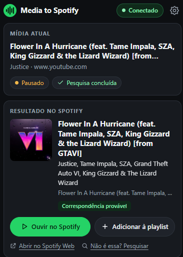

# Media to Spotify

Extensão para o **Google Chrome** (Manifest V3) que descobre qual música ou vídeo está tocando em uma aba, **encontra a faixa
correspondente no Spotify** e deixa você **abri-la** ou **salvá-la em uma ou mais playlists suas** com um clique.

Funciona com YouTube, YouTube Music, SoundCloud, Bandcamp, Deezer, TIDAL e Apple Music, e pode ser habilitada em outros sites
sob demanda. Usa apenas o título e os metadados que a própria página já mostra: **não grava nem analisa áudio**.



*Exemplo real: o vídeo do YouTube (pausado) foi identificado, a pesquisa foi concluída e o popup mostra a faixa encontrada no
Spotify com capa, artistas, álbum e o nível de confiança, além dos botões **Ouvir no Spotify**, **Adicionar à playlist**,
**Abrir no Spotify Web** e **Não é essa? Pesquisar**.*

> Projeto independente, sem afiliação com o Spotify. "Spotify" é marca de seus respectivos titulares.

---

## Índice

- [O que a extensão faz](#o-que-a-extensão-faz)
- [Requisitos](#requisitos)
- [Instalação](#instalação)
- [Configuração](#configuração)
- [Como usar](#como-usar)
- [Permissões e privacidade](#permissões-e-privacidade)
- [Como funciona por dentro](#como-funciona-por-dentro)
- [Testes](#testes)
- [Limitações conhecidas](#limitações-conhecidas)
- [Solução de problemas](#solução-de-problemas)

---

## O que a extensão faz

### Detecta a mídia que está tocando
- Reconhece elementos HTML5 `<video>` e `<audio>`, inclusive os criados com `new Audio()` e nunca inseridos na página
  (caso de players como o do SoundCloud).
- Acompanha **início, pausa e fim** da reprodução e percebe quando a **faixa muda sem recarregar a página** (playlists do
  YouTube Music, reprodução automática do YouTube etc.).
- Ignora **anúncios do YouTube** e pré-visualizações ao passar o mouse, para não pesquisar o anúncio no lugar da música.
- Com várias mídias na mesma página, escolhe a que está de fato tocando (de preferência a que tem som).
- Captura título e, quando disponíveis, **artista, álbum, canal, duração e capa**.
- O título vem da melhor fonte disponível, nesta ordem: **player da página** → **Media Session API** → título do elemento
  de mídia → título da aba.

### Entende títulos "sujos"
O texto de um vídeo raramente é só o nome da música. A extensão limpa e interpreta:
- ruído como `(Official Video)`, `[HD]`, `4K`, `Lyrics`, `Music Video`, mesmo sem parênteses, e emojis;
- `Artista - Música` nas duas ordens, usando o nome do canal para decidir (inclusive canais `- Topic` e `VEVO`);
- `Artista「Música」`, `Artista "Música"` e `【Artista】Música`;
- participações (`feat.`, `ft.`) e marcas de versão (live, remix, acústica, instrumental, remaster, karaokê…);
- **nome alternativo entre parênteses**, como a romanização `好きでいて (Suki de Ite)`: o Spotify costuma catalogar por um
  dos dois nomes, então ambos são tentados;
- qualquer idioma e escrita (japonês, coreano, cirílico, acentos etc.).

### Procura no Spotify e classifica os resultados
- Usa a **Spotify Web API**, com no máximo 4 consultas por mídia (a busca para assim que acha uma correspondência firme).
- Pontua cada candidata por **título, artista, versão** (uma versão ao vivo não vence a de estúdio se o vídeo não é ao vivo),
  **duração** e **disponibilidade na sua região**, e descarta karaokês e tributos.
- Mostra o **nível de confiança**: *Correspondência provável*, *Confira se é a mesma música*, *Possível correspondência* ou
  *Pouco provável*. Palpites fracos só aparecem quando não há nada melhor.
- Remove duplicatas (a mesma gravação em vários álbuns) e oferece **outras possibilidades** para você trocar o resultado.
- Quando a correspondência não é firme, um bloco **Detalhes técnicos** mostra o que foi pesquisado e o que o Spotify devolveu.
- **Cache** local (7 dias para encontrados, 30 minutos para não encontrados), deduplicação de buscas e respeito ao limite de
  requisições do Spotify (`Retry-After`).
- Sempre há um link de **pesquisa manual** no Spotify, que não exige login.

### Abre a faixa
- **Ouvir no Spotify** pede ao Chrome para abrir o aplicativo (`spotify:track:…`). Como o navegador não confirma se o app abriu,
  a interface avisa e oferece o caminho alternativo.
- **Abrir no Spotify Web** abre `open.spotify.com/track/…` em uma nova aba.
- Nas configurações você escolhe qual dos dois é o padrão. Nada começa a tocar sozinho e **não é preciso Premium** só para abrir
  o link.

### Salva em playlists
- Lista **todas as suas playlists** com capa e quantidade de faixas, com **busca** e botão para **atualizar sem desconectar**.
- Permite **marcar várias playlists** e salvar a faixa em todas de uma vez; o resultado aparece **por playlist**.
- **Pré-seleciona** as playlists onde você salvou da última vez.
- **Avisa antes de duplicar**: se a faixa já está na playlist, não adiciona e oferece *Adicionar mesmo assim*. Uma duplicata
  em uma playlist não impede as outras.
- Playlists **somente leitura** (de outras pessoas, sem edição) aparecem desabilitadas; colaborativas são aceitas.
- Pode **criar uma playlist nova** (privada por padrão) já com a faixa dentro.

### Conta e segurança
- Login com **OAuth 2.0 Authorization Code + PKCE** (sem *client secret*), validando o parâmetro `state`.
- Pede só os escopos necessários: `playlist-read-private`, `playlist-read-collaborative`, `playlist-modify-private` e
  `playlist-modify-public`.
- Renova o token automaticamente e trata expiração e revogação. **Desconectar** apaga tokens, perfil e cache de playlists.
- Os tokens ficam acessíveis apenas ao service worker da extensão; nem o popup nem as páginas visitadas os recebem.

### Interface
- Popup escuro e leve, com estados claros: nenhuma mídia, mídia identificada, pesquisando, resultado encontrado, não
  encontrado, não conectado, erro de conexão/permissão, faixa adicionada e faixa já presente.
- Selo no ícone da extensão: **✓** quando há correspondência e **?** quando é só um palpite.
- Página de configurações com Client ID, Redirect URI, preferências e sites habilitados por você.

---

## Requisitos

- **Google Chrome 116** ou superior.
- **Node.js 20** ou superior (para compilar a extensão).
- Uma **conta Spotify** para entrar e um **app no Spotify Developer Dashboard** (veja [Configuração](#configuração)).

> **Importante sobre o Spotify.** A Web API do Spotify exige login de usuário até para buscar músicas, e cada pessoa precisa
> usar um app próprio: apps em *Development Mode* exigem que **quem criou o app tenha Spotify Premium** e aceitam até
> **5 usuários cadastrados**. A liberação para usuários ilimitados (*extended quota*) é restrita a organizações. Por isso o
> Client ID é configurado por você, e não vem embutido na extensão.

---

## Instalação

```bash
git clone https://github.com/Teus42/MediaToSpotify.git
cd MediaToSpotify
npm install      # há um .npmrc com legacy-peer-deps=true (contorna um bug do npm 11 com peer deps)
npm run build    # gera a pasta dist/
```

Depois, no Chrome:

1. Abra `chrome://extensions` e ative o **Modo do desenvolvedor**.
2. Clique em **Carregar sem compactação** e escolha a pasta **`dist/`** do projeto.
3. Anote o **ID** da extensão (algo como `abcdefghijklmnopabcdefghijklmnop`): ele define o Redirect URI da configuração.
4. Fixe a extensão na barra do Chrome para acessar o popup.

> O ID de uma extensão carregada sem compactação depende da **pasta** de onde ela foi carregada. Se você mover a pasta, o ID muda
> e o Redirect URI precisa ser atualizado no Dashboard. Para um ID fixo, gere uma chave (`key`) e adicione-a ao
> `src/manifest.json` ([instruções do Chrome](https://developer.chrome.com/docs/extensions/reference/manifest/key)).

Durante o desenvolvimento, `npm run watch` recompila ao salvar (depois use **Recarregar** em `chrome://extensions`). Para
atualizar uma instalação existente: `git pull`, `npm run build` e **Recarregar** a extensão.

---

## Configuração

### 1. Criar o app no Spotify Developer Dashboard

1. Entre em <https://developer.spotify.com/dashboard> com uma conta **Premium** (exigência do *Development Mode*).
2. Clique em **Create app**. Nome e descrição são livres. Em **Which API/SDKs are you planning to use?** marque **Web API**.
3. Em **Redirect URIs**, cadastre exatamente o endereço mostrado em *Configurações da extensão → Redirect URI*:

   ```
   https://<ID-DA-EXTENSÃO>.chromiumapp.org/
   ```

   (com a barra final). Salve.
4. Em **Settings → User Management**, adicione o e-mail de cada pessoa que vai usar o app (até 5). Quem não estiver na lista
   recebe erro 403.
5. Copie o **Client ID**. Não existe *client secret* neste fluxo e **ele nunca deve ser colocado na extensão**.

### 2. Configurar a extensão

1. Clique no ícone da extensão e na **engrenagem** (ou abra *Detalhes → Opções da extensão*).
2. Cole o **Client ID** e clique em **Salvar Client ID**.
3. Clique em **Conectar ao Spotify** e autorize os escopos pedidos.

> A janela de login tira o foco do popup e o Chrome o fecha: é normal. O login continua em segundo plano. Conecte pela página de
> configurações (que não fecha) ou reabra o popup depois.

### 3. Preferências (opcional)

| Opção | O que faz |
|---|---|
| Pesquisar automaticamente | Procura no Spotify assim que uma mídia começa a tocar (ligado por padrão). |
| "Ouvir no Spotify" abre… | O aplicativo (`spotify:`) ou direto o Spotify Web. |
| País | Código de 2 letras (ex.: `BR`, `US`) para a disponibilidade das faixas. Em branco, usa a região do idioma do navegador. |
| Sites habilitados | Lista os sites extras que você liberou; dá para remover cada um. |
| Limpar cache | Apaga o cache de buscas e de playlists. |

---

## Como usar

1. **Toque algo** em um site compatível. Em instantes o popup mostra a **Mídia atual**, o andamento da pesquisa e o
   **Resultado no Spotify**.
2. Confira o nível de confiança. Se não for a música certa, abra **Outras possibilidades** ou use **Não é essa? Pesquisar**.
3. Clique em **Ouvir no Spotify** ou **Abrir no Spotify Web**.
4. Clique em **Adicionar à playlist**, marque uma ou mais playlists (ou crie uma nova) e confirme. O resultado aparece por
   playlist.

**Sites compatíveis por padrão:** YouTube, YouTube Music, SoundCloud, Bandcamp, Deezer, TIDAL e Apple Music.

**Outros sites:** quando o popup não encontra mídia, ele oferece:
- **Detectar nesta aba**: injeção única, vale até a aba navegar (se a mídia já estava tocando, pause e dê play de novo);
- **Sempre neste site**: o Chrome pede a permissão *daquele* site e o detector passa a rodar nele (revogável nas configurações).

O botão **Detectar nesta aba** também ajuda em abas abertas antes de instalar ou recarregar a extensão: o Chrome não injeta
scripts nelas automaticamente.

---

## Permissões e privacidade

| Permissão | Para quê |
|---|---|
| `storage` | Configurações, tokens, cache e estado das abas. |
| `identity` | Janela de login do Spotify (`launchWebAuthFlow`) e Redirect URI. |
| `activeTab` | "Detectar nesta aba" em sites fora da lista, sob demanda. |
| `scripting` | Injetar o detector nessa aba e registrá-lo nos sites que você habilitar. |
| Acesso a `api.spotify.com` e `accounts.spotify.com` | Chamadas à Web API e troca/renovação de tokens. |
| Content scripts nos 7 sites da lista | Detectar a mídia. Um deles (`page-hook`) roda no contexto da página só para enxergar `<audio>` criado fora do DOM; não lê áudio nem altera a reprodução. |
| Acesso opcional a `http(s)://*/*` | Só é solicitado, **site a site**, quando você clica em "Sempre neste site". |

Não pede `tabs` e **não tem acesso a todos os sites por padrão**.

- Os títulos são interpretados **localmente**. Para pesquisar, só o texto da busca vai ao Spotify.
- **Sem servidor próprio, sem análise de uso, sem telemetria.** Nenhum histórico de navegação é coletado.
- Ficam no navegador: título, artista e site da mídia atual de cada aba (por sessão), cache de buscas e playlists, e os tokens.
- Os tokens ficam em `chrome.storage.local`, **que o Chrome não criptografa** (vale para qualquer extensão). **Desconectar**
  apaga tudo. O Spotify não oferece endpoint de revogação para PKCE: para revogar também no servidor, remova o app em
  <https://www.spotify.com/account/apps/>. Refresh tokens duram 6 meses; depois disso é preciso conectar de novo.

---

## Como funciona por dentro

```
 página (YouTube…)              service worker (MV3)                       popup / opções
┌──────────────────┐  media:*  ┌───────────────────────────────────┐ mensagens ┌────────────────┐
│ content script   │──────────▶│ Router → TabsStore (storage.session)│◀─────────│ UI (só DOM)    │
│ MediaDetector    │           │        → SearchService → cache     │           │ sem tokens     │
│ adaptadores +    │           │        → PlaylistService           │           └────────────────┘
│ Media Session    │           │ AuthService (PKCE, tokens)         │
│ page-hook (MAIN) │           │ SpotifyClient (401/429/5xx)        │──▶ accounts/api.spotify.com
└──────────────────┘           └───────────────────────────────────┘
```

- **O service worker não guarda estado em memória.** Estado por aba fica em `chrome.storage.session`; cache e tokens em
  `chrome.storage.local`. Se o Chrome suspender o worker, nada se perde.
- **Tokens só existem no service worker.** O popup e as opções pedem operações por mensagem; o worker só aceita operações
  privilegiadas de páginas da própria extensão e valida tudo que vem do content script.
- **Linguagem:** TypeScript estrito, empacotado com esbuild; testes com Vitest.

```
src/
  background/   service worker: roteador, busca, playlists, cache, sites, selo do ícone
  content/      detector de mídia, extração de metadados, adaptadores (youtube, ytmusic, soundcloud), page-hook
  matching/     consultas de busca e classificação dos resultados
  metadata/     normalização de títulos e similaridade de texto
  spotify/      cliente HTTP, PKCE/OAuth, busca, playlists
  popup/ options/  interface
  shared/       tipos, mensagens, storage, constantes
tests/          unitários e de integração (com Spotify e chrome.storage simulados)
e2e/            teste em Chrome real contra um Spotify simulado
scripts/        gerador dos ícones
```

---

## Testes

```bash
npm run typecheck   # TypeScript estrito
npm test            # testes unitários e de integração (Vitest)
npm run e2e         # E2E em Chrome real (perfil temporário) contra um Spotify simulado
npm run check       # typecheck + testes + build
```

| Camada | O que cobre |
|---|---|
| Unitários | Normalização de títulos, ordem Artista/Título, apelidos, pontuação e desempate dos resultados. |
| DOM (jsdom) | Prioridade das fontes de título, adaptadores, anúncios, várias mídias, troca de faixa, mídia fora do DOM, **todos os estados do popup** e proteção contra HTML injetado. |
| Integração | PKCE como o servidor valida (inclusive o vetor da RFC 7636), `state`, renovação de token, `invalid_grant`, 401/429/5xx, paginação de playlists, duplicatas, criação, cache, limite de requisições, suspensão do worker. |
| E2E | A extensão real no Chrome: detecção via Media Session e `new Audio()`, `launchWebAuthFlow` + PKCE, busca, popup, abrir no Spotify Web, filtro/seleção múltipla/pré-seleção/duplicata/criação de playlist e desconectar. |
| Manifest | Permissões mínimas, sites do manifest iguais à lista do popup, ausência de segredos. |

O E2E empacota uma **variante de teste** em `e2e/.out/` (o código real não muda) cujas URLs do Spotify apontam para
`127.0.0.1:8777`, onde roda um servidor simulado. Defina `CHROME_PATH` se o Chrome não estiver no caminho padrão. (Versões
recentes do Chrome ignoram `--load-extension`; o E2E usa a API `enableExtensions` do Puppeteer.) `npm run e2e:youtube` é uma
sonda manual contra o YouTube real.

**Status de validação:** a lógica é coberta pelos testes acima, e o fluxo completo (login, busca, abrir, adicionar a
playlists) foi usado manualmente com o Spotify real no YouTube e no SoundCloud. Os adaptadores de Bandcamp, Deezer, TIDAL e
Apple Music dependem da Media Session do site e **não foram verificados manualmente**.

---

## Limitações conhecidas

- Exige Client ID próprio, conta Premium para quem cria o app e usuários cadastrados (*Development Mode*). Sem login só há
  pesquisa manual.
- Seletores de DOM do YouTube, YouTube Music e SoundCloud podem quebrar quando o site mudar; nesse caso a extensão cai para a
  Media Session e o título da aba, com menos precisão.
- Vídeos que não são música, *mashups*, trechos e títulos sem artista geram confiança baixa ou "pouco provável". Versões
  alternativas (live, remix, remaster) são diferenciadas por heurística e podem errar.
- Não lê mídia dentro de `<iframe>`s (ex.: vídeo do YouTube incorporado em outro site), em *shadow DOM* fechado, nem em páginas
  que o Chrome proíbe (Chrome Web Store, `chrome://`).
- Em "Detectar nesta aba" só se vê mídia que tocar **depois** da injeção.
- A disponibilidade regional só é sinalizada quando o Spotify devolve `is_playable`. A verificação de duplicatas varre até 1.000
  itens por playlist; acima disso adiciona sem verificar.
- O Chrome fecha o popup quando a janela de login abre (comportamento do navegador).
- Interface somente em português (pt-BR).

---

## Solução de problemas

| Sintoma | Causa provável |
|---|---|
| `INVALID_CLIENT: Invalid redirect URI` no login | O Redirect URI no Dashboard difere do mostrado nas Configurações (o ID da extensão mudou? falta a `/` final?). |
| "O Spotify negou o acesso" (403) em tudo | Seu e-mail não está em *User Management*, quem criou o app não tem Premium, ou falta um escopo. |
| 403 só na busca | Acrescente `user-read-private` em `SPOTIFY_SCOPES` (`src/shared/constants.ts`) e conecte de novo. |
| "Muitas requisições" | Limite do Spotify; aguarde o tempo indicado. |
| Nada é detectado | O site não está na lista (use "Detectar nesta aba"), a aba foi aberta antes da extensão (recarregue-a) ou a mídia está em um `<iframe>`. |
| Resultado errado ou "não encontrado" | Veja *Outras possibilidades* e os *Detalhes técnicos*, ou use a pesquisa manual. |
